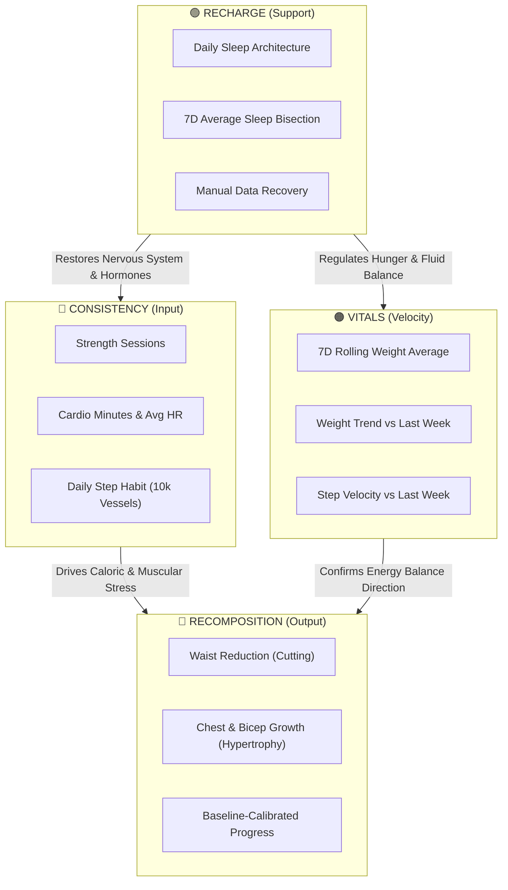

# HealthHUD ⚡
### The Self-Hosted Personal Health & Fitness Command Center

[](https://www.docker.com/)
[](https://casaos.io/)
[](https://nextjs.org/)
[](https://www.prisma.io/)
[](https://opensource.org/licenses/MIT)

**HealthHUD** is a high-visibility, 24/7 personal health command center built to run on your home server (**CasaOS, Proxmox VE, Ubuntu, or Debian Linux**). 

Instead of juggling four separate smartphone apps, wrestling with broken Google Sheets, or tolerating sync scripts that double-count workouts, HealthHUD aggregates live biometric streams from **Apple Health (via Health Auto Export)**, **Withings Smart Scales**, and manual tape measurements into a unified **4-Quadrant Tactical Command Center**.

---

## 🧭 System Architecture & Concept Matrix

HealthHUD organizes human health into four interconnected operational pillars:

```
┌─────────────────────────────────────────┬─────────────────────────────────────────┐
│  🟠 1. VITALS COMMAND                   │  🌸 2. CONSISTENCY TRACKER              │
│  Metabolic Direction & Daily Velocity   │  Discipline, Output & Cardiovascular    │
│                                         │                                         │
│  • Current Scale Weight (lbs)           │  • Strength Battle Map (Mon–Sun)        │
│  • 7-Day Rolling Weight Average         │  • Completed Strength Sessions vs Target│
│  • 7-Day Weight Trend (Delta vs Prev)   │  • Weekly Average Daily Calorie Burn    │
│  • Interactive Mon–Sun Weight Sparkline │  • Cumulative Cardio Sessions & Minutes │
│  • 7 Mon–Sun Step Goal Vessels (0-100%) │  • Cardio-Specific Average Heart Rate   │
│  • 3-Tile Step Velocity Matrix          │  • Floating Itemized Workout Inspector  │
├─────────────────────────────────────────┼─────────────────────────────────────────┤
│  🟢 3. RECHARGE & SLEEP                 │  🔵 4. MEASUREMENTS & RECOMPOSITION     │
│  Restoration & Neurological Readiness   │  Anatomical Growth & Hypertrophy        │
│                                         │                                         │
│  • Last Night Sleep Duration (Hours)    │  • Calibrated Starting Baselines        │
│  • True 7-Day Average Sleep (Active)    │  • Current Circumference Readings       │
│  • Mon–Sun Absolute Sleep Columns       │  • Target Goals (Inches)                │
│  • Synchronized 7D Average Bisection    │  • Bidirectional Progress Bars (% Met)  │
│  • Manual Log Diagonal Stripe Styler    │  • Inches Remaining to Target           │
│  • Locked-Date Sleep Edit Modal         │  • Quick-Log Tape Entry & Goal Editor   │
└─────────────────────────────────────────┴─────────────────────────────────────────┘
```

---

## 📊 Comprehensive Metric Breakdown

### 🟠 Quadrant 1: Vitals Command (Top-Left)
**Operational Purpose:** Tracks fundamental metabolic direction, fluid balance, and baseline physical activity.

| Measurement | Unit / Format | Data Source | Calculation / Logic | Significance & Interpretation |
| :--- | :--- | :--- | :--- | :--- |
| **Current Weight** | `XXX.X lbs` | Withings Smart Scale / Manual Entry (`+`) | Most recent record in `WeightLog` table sorted by `date desc`. | Raw daily weigh-in. Provides immediate tactical feedback on daily body mass. |
| **7-Day Rolling Average** | `XXX.X lbs` | Withings / `WeightLog` | Mean of all weigh-ins in the rolling 7-day window: `Σ(weights) / count`. | **Filters out daily water weight fluctuations.** Normalizes sodium spikes, glycogen storage, and hydration shifts to reveal true tissue loss or gain. |
| **7-Day Weight Trend** | `↓/↑ X.X LBS vs Last Wk` | Withings / `WeightLog` | `currentSevenDayAvg - prevSevenDayAvg` (where previous is days 8–14 ago). | **Metabolic velocity indicator.** Demonstrates whether your current caloric balance is in a surplus, deficit, or maintenance phase week-over-week. |
| **Weight Sparkline** | Glowing SVG Curve | Withings / `WeightLog` | Cubic Bézier SVG curve plotted across Monday–Sunday coordinate nodes. | Visualizes day-to-day weight trajectory across the current calendar week. Hovering any node displays date and exact weight. |
| **7 Step Goal Vessels** | 7 Liquid Rings (`M`–`S`) | Apple HealthKit (`HealthMetric`) | `min(100, (dailySteps / stepGoal) * 100)`. Vessel fills from bottom to top. | **Daily Habit Consistency.** Each circle represents one calendar day. Completing the daily step goal (e.g. 10,000 steps) triggers a neon emerald glow, ring highlight, and checkmark (`✓`). |
| **Today's Steps** | Integer (`XX,XXX`) | Apple HealthKit | Latest monotonic step count recorded for today's date. | Real-time daily physical activity. |
| **Avg Daily Steps** | `X,XXX /d` | Apple HealthKit | `thisWeekTotalSteps / daysElapsedThisWeek` vs `lastWeekTotalSteps / 7`. | **Weekly Baseline Activity Level.** Evaluates non-exercise physical activity (NEAT). Shows positive (`+`) or negative (`-`) delta against last week's daily average. |
| **This Week's Steps** | Cumulative Integer | Apple HealthKit | Sum of all steps logged from Monday 00:00:00 UTC to now. | **Macro Activity Volume.** Compares cumulative weekly volume against the previous week's total steps. |

---

### 🌸 Quadrant 2: Consistency Tracker (Top-Right)
**Operational Purpose:** Measures training discipline, physical output, work capacity, and cardiovascular conditioning.

| Measurement | Unit / Format | Data Source | Calculation / Logic | Significance & Interpretation |
| :--- | :--- | :--- | :--- | :--- |
| **Strength Target** | `X / Y Sessions` | Apple HealthKit (`Workout` table) | Count of workouts classified as `strength` this week vs `Goal("StrengthSessions")`. | **Anabolic Consistency.** Tracks adherence to resistance training programming. Automatic reset at midnight Monday. |
| **Mon–Sun Strength Battle Map** | 7 Horizontal Pill Bars | Apple HealthKit (`Workout` & `HealthMetric`) | Boolean per day: `true` if strength session logged on that calendar day. | Visual scorecard for weekly workout distribution. Lights up **Emerald Green** on training days; displays dark/red on rest days. Hovering displays workout name, date, and duration (`MM:SS`). |
| **Weekly Daily Burn Avg** | `X Kcals` | Apple HealthKit (`active_energy`) | `Σ(thisWeekCaloriesBurned) / daysElapsedThisWeek`. | **Energy Output & Metabolic Burn Rate.** Reflects total active calories expended through exercise and daily movement. |
| **Cardio Sessions** | Count (`X`) | Apple HealthKit (`Workout`) | Count of discrete workouts classified as `cardio` (Running, Cycling, Walking, HIIT, Elliptical). | **Cardiovascular Frequency.** Tracks how many times cardiovascular strain was applied during the week. |
| **Cardio Minutes** | Minutes (`X`) | Apple HealthKit (`durationSec`) | Sum of duration seconds across cardio workouts converted to minutes: `round(Σ(sec) / 60)`. | **Cardiovascular Volume.** Total time under cardiovascular stress. |
| **Cardio Avg HR** | BPM (`XXX`) | Apple HealthKit (`Workout.avgHeartRate`) | Mean heart rate across all cardio sessions logged this week. | **Cardiovascular Conditioning.** Specifically isolates workout heart rate during cardio bouts, filtering out resting heart rate and strength workouts to monitor aerobic efficiency and heart-rate control. |
| **Workout Inspector** | Popover Overlay | Apple HealthKit | Real-time client popover on hover. | Audits exact workout records: displays session date, exercise name, precise duration in `MM:SS`, and average heart rate. |

---

### 🟢 Quadrant 3: Recharge & Sleep (Bottom-Left)
**Operational Purpose:** Quantifies biological recovery, nervous system restoration, and readiness for physical exertion.

| Measurement | Unit / Format | Data Source | Calculation / Logic | Significance & Interpretation |
| :--- | :--- | :--- | :--- | :--- |
| **Last Night Sleep** | `X.X HRS` | Apple HealthKit (`sleep_analysis`) / Manual Log | Most recent night's recorded sleep duration in hours. | Immediate recovery indicator. Informs readiness and load tolerance for the day's training. |
| **7-Day Average Sleep** | `7D AVG: X.X HRS` | Apple HealthKit / Manual Log | `Σ(sleepHours) / recordedDaysCount` (computed **only** over days where `sleepHours > 0`). | **Baseline Sleep Capacity.** Excludes unlogged days so missing data does not artificially depress your recovery baseline. |
| **Mon–Sun Sleep Columns** | Vertical Bar Chart | Apple HealthKit / Manual Log | Absolute baseline-positioned columns scaled to `maxScale = max(8, maxHours * 1.15, avgHours * 1.15)`. | Visual sleep architecture across the current calendar week. Heights represent relative sleep duration. |
| **7D Average Bisection Line** | Dashed Horizontal Line | Dynamic CSS coordinate | Zero-height line (`h-0 border-t-2 border-dashed`) positioned at `bottom: (7DAvg / maxScale) * 100%`. | **Immediate Performance Evaluation.** Nights where you slept above your weekly average stand above the line; nights with insufficient sleep sit below the line. |
| **Manual Override Flag** | Diagonal Stripes + `✎` | Manual Sleep Edit Modal | Stored in SQLite as `sleepManual: true`. Overwrite protection active. | Clearly differentiates manually logged/edited sleep from Apple Health automated sync. Diagonal striped pattern (`repeating-linear-gradient`) and cyan border highlight. |
| **Locked-Date Edit Modal** | Interactive Dialog | User Input | Fast quick-pick chips (6h, 7h, 7.5h, 8h, 8.5h) or custom decimal input locked to the selected day. | Solves missing data when your watch dies or is left on the charger. Preserves historical accuracy without corrupting other days. |

---

### 🔵 Quadrant 4: Measurements & Recomposition (Bottom-Right)
**Operational Purpose:** Measures anatomical hypertrophy, fat distribution, and physical body recomposition independent of scale weight.

| Measurement | Unit / Format | Data Source | Calculation / Logic | Significance & Interpretation |
| :--- | :--- | :--- | :--- | :--- |
| **Calibrated Starting Baseline** | Inches (`XX.X"`) | `Goal.startValue` / Earliest Log | Initial starting circumference set by the user or derived from the earliest log. | **True Progress Zero-Point.** Prevents false progress illusions (e.g. standard fitness trackers that show 80% progress on day one because they measure from zero). |
| **Current Reading** | Inches (`XX.X"`) | `BodyMeasurement` table | Most recent tape measurement for the given anatomical site (`chest`, `waist`, `biceps`). | Current physical dimension of the muscle group or fat storage site. |
| **Target Goal** | Inches (`XX.X"`) | `Goal.targetValue` | User-defined target goal set in the Goal Customizer (`⚙️`). | The target milestone for that anatomical measurement. |
| **Bidirectional Progress Bar** | Visual Fill (`0%`–`100%`) | Computed in Dashboard API | **Cutting Goal** (`target < start`): `(start - current) / (start - target) * 100`<br>**Growth Goal** (`target > start`): `(current - start) / (target - start) * 100` | **Directional Progress Intelligence.** Automatically handles fat loss goals (waist reduction) and hypertrophy goals (bicep growth) simultaneously without manual configuration. |
| **Inches to Target** | `Diff: X.X"` | Dashboard API | `abs(current - target)`. | Quantifies the exact physical distance remaining to reach the anatomical goal. |
| **Tape Measurement Entry** | Interactive Modal (`+`) | User Input | Saves new timestamped measurements in `BodyMeasurement`. | Enables easy tape logging with date verification. |

---

## 🧠 Conceptual Synthesis: How the HUD Drives Results

HealthHUD connects four vital dimensions of physical development into a continuous operational feedback loop:



1. **Consistency (Input):** You cannot manage what you do not execute. The Consistency Tracker logs workout frequency, cardio volume, and daily movement.
2. **Recharge (Support):** High training stress without adequate recovery causes systemic burnout and elevated cortisol. The Recharge quadrant ensures sleep hours match physical demands.
3. **Vitals (Velocity):** Scale weight fluctuates daily due to hydration, sodium, and muscle glycogen. The 7-Day Rolling Average filters out the noise to confirm the authentic metabolic trend.
4. **Growth & Recomposition (Output):** Scale weight does not distinguish between fat and muscle. The Body Measurements quadrant tracks true anatomical changes—shrinking waist (fat loss) and expanding biceps/chest (muscle hypertrophy).

---

## 🔄 Dual-Engine Automated Ingestion

### 1. Apple Health (via Health Auto Export Webhook)
HealthHUD provides a dedicated ingestion endpoint at `/api/ingest/apple-health`:
* **HealthKit UUID Deduplication:** Workouts and metrics are cross-referenced with Apple HealthKit UUIDs and composite start/end timestamps. Webhooks can trigger 50 times a day with **zero duplicate workouts or inflated minutes**.
* **Same-Day Multiple Sessions:** Two distinct 30-minute runs in the same day correctly register as **2 sessions / 60 minutes**, preserving individual workout integrity.
* **Monotonic Daily Step Totals:** Eliminates spreadsheet bugs where step syncs re-accumulate. Always updates to your highest verified daily total.
* **Deep Heart Rate Parsing:** Traverses nested HealthKit JSON structures (`qty`, `avg`, sample arrays) to extract true workout BPM.
* **Manual Sleep Protection:** If you manually log or edit sleep for a specific date, incoming Apple Health sync payloads respect the `sleepManual: true` lock and will not overwrite your entry.

### 2. Withings Smart Scales
* **Automated 15-Minute Background Daemon:** Queries the Withings API automatically to pull new scale weigh-ins without user intervention.
* **One-Click Instant Sync (`🔄 Sync Withings`):** Step off the scale and trigger an instant pull in ~2 seconds.
* **14-Day Lookback Window:** Resilient against scale Wi-Fi drops or delayed synchronization.
* **Automatic OAuth2 Token Rotation:** Refreshes access tokens seamlessly in the background.

---

## 🚀 One-Line Installation & Updates

Deploy or update HealthHUD on **CasaOS, Proxmox VE, Ubuntu, or Debian Linux**:

```bash
curl -fsSL https://raw.githubusercontent.com/ProdeaGG/HealthHUD/main/install.sh | bash
```

**What the installer does:**
1. Verifies Git, Docker, and Docker Compose.
2. Clones or pulls the repository to `/DATA/AppData/HealthHUD`.
3. Runs safe, non-destructive Prisma schema migrations (`npx prisma db push`).
4. Rebuilds and restarts the container with zero data loss.
5. Surfaces HealthHUD on port `3000` of your server.

---

## 🛠️ Tech Stack & Database Architecture

* **Framework:** Next.js 15 (App Router, Server Actions, Client Components)
* **Language:** TypeScript 5 (Strict Mode)
* **Styling:** Tailwind CSS with retro-clinical military-grade dark HUD aesthetic
* **Database:** SQLite (`/data/dev.db` persisted across container rebuilds)
* **ORM:** Prisma Client with strict schema models (`HealthMetric`, `WeightLog`, `Workout`, `BodyMeasurement`, `Goal`, `Settings`)
* **Containerization:** Node.js 20 on Alpine Linux via Docker Compose

---

## 📄 License
MIT License. Built for lifters, biohackers, and self-hosters.
